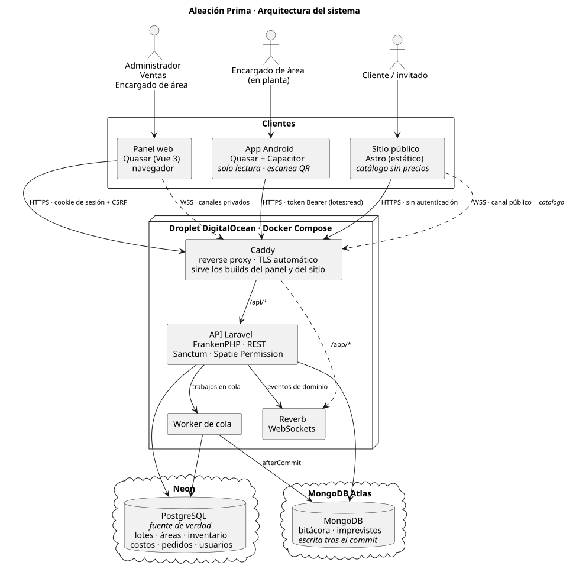
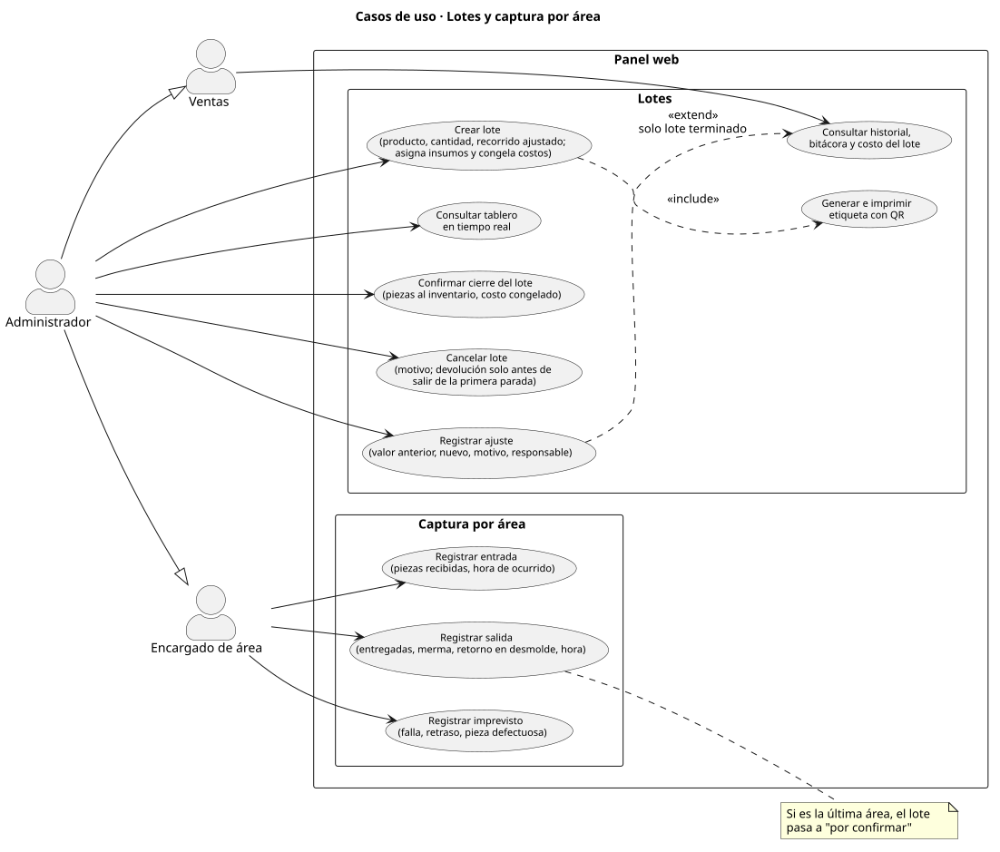
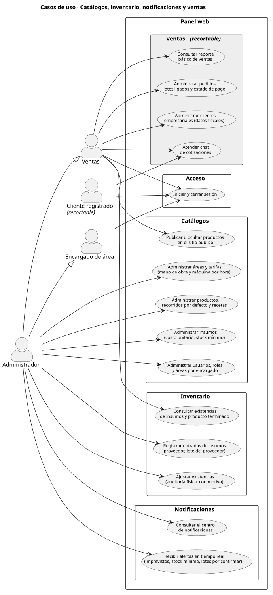
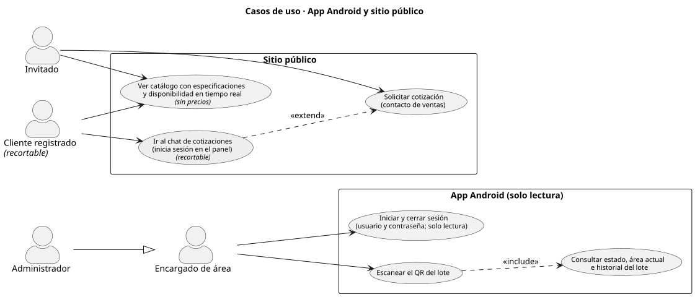
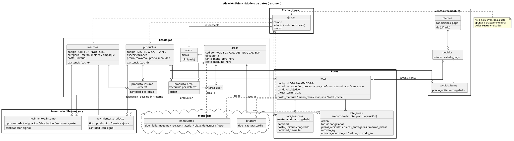
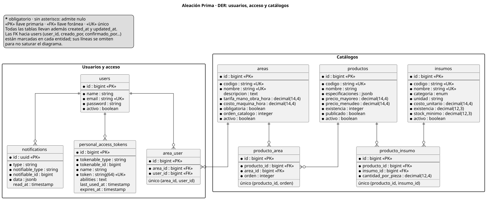
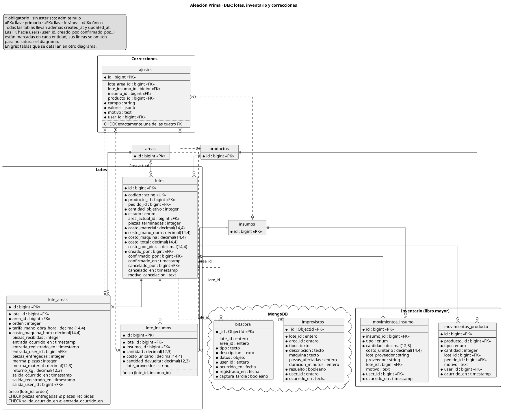
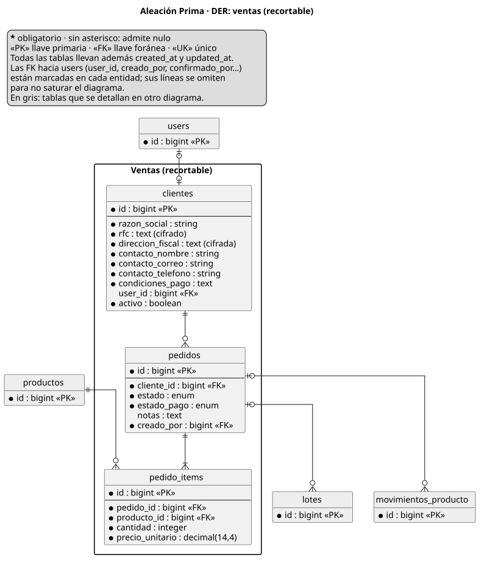

# Aleación Prima — Sistema de trazabilidad de lotes

Sistema web para registrar el recorrido de cada lote de producción por las áreas de una fundición (piezas, merma, retornos, tiempos, responsables e imprevistos) y calcular su costo real por lote y por pieza.

**Equipo:** Humberto Castro Cortes (Product Owner), Cesar Leonel Morillon González (Scrum Master), Julio Alberto López Castro y Paloma Johana Portillo Hernández.

| Pieza                   | Carpeta      | Para quién                                 |
| ----------------------- | ------------ | ------------------------------------------ |
| API (Laravel)           | `apps/api`   | Todo lo demás                              |
| Panel web + app Android | `apps/panel` | Administrador, ventas y encargados de área |
| Sitio público           | `apps/web`   | Clientes e invitados                       |

La documentación técnica está en [`docs/`](./docs/README.md); las decisiones de diseño, en [`docs/decisiones/`](./docs/decisiones/README.md).

## Índice

- [Unidad 1: Anteproyecto](#unidad-1-anteproyecto)
- [Unidad 2: Control de versiones, diagramas, diccionario de datos, maquetado y prototipado](#unidad-2-control-de-versiones-diagramas-diccionario-de-datos-maquetado-y-prototipado)
- [Guía de instalación y trabajo diario](#guía-de-instalación-y-trabajo-diario)

## Unidad 1: Anteproyecto

El anteproyecto se entregó el 4 de octubre de 2026 y se conserva en Google Drive, en la misma carpeta que la hoja del cronograma (Gantt); esa es su versión de referencia:

**[Anteproyecto: Sistema de trazabilidad de lotes para empresa metalúrgica](https://drive.google.com/drive/u/0/folders/1AhmPgR9m7Az-N4vhDoi3fm69OVoWu3hF)**

Sus trece secciones son: problemática; objetivo general y específicos; justificación; alcances, limitaciones y MVP; análisis de riesgos; metodología y roles; tecnologías y herramientas; requerimientos funcionales y no funcionales con casos de uso; patrones de diseño; separación en tareas; cronograma e hitos; wireframes; y definición de contenido.

La parte técnica del anteproyecto se mantiene en Markdown dentro del repositorio, que es donde se actualiza conforme avanza el desarrollo:

| Sección del anteproyecto            | Dónde vive en el repositorio                                                                                            |
| ----------------------------------- | ----------------------------------------------------------------------------------------------------------------------- |
| 1. Problemática (la empresa)        | [`docs/empresa.md`](./docs/empresa.md)                                                                                  |
| 7. Tecnologías y arquitectura       | [`docs/arquitectura.md`](./docs/arquitectura.md) y [`docs/decisiones/`](./docs/decisiones/README.md)                    |
| 8. Requerimientos y casos de uso    | [`docs/requerimientos.md`](./docs/requerimientos.md) y [`docs/diagramas/casos-de-uso/`](./docs/diagramas/casos-de-uso/) |
| 9. Patrones y modelo de datos       | [`docs/modelo-datos.md`](./docs/modelo-datos.md) y [`docs/flujo-lote.md`](./docs/flujo-lote.md)                         |
| 10 y 11. Tareas y cronograma        | Tablero de GitHub Projects (ver [evidencias](#repositorio-en-funcionamiento-y-evidencias))                              |
| 12. Mapa de navegación y wireframes | [`docs/diagramas/mapa-navegacion.puml`](./docs/diagramas/mapa-navegacion.puml) y el [maquetado](#maquetado)             |
| 13. Vocabulario de la planta        | [`docs/glosario.md`](./docs/glosario.md)                                                                                |

## Unidad 2: Control de versiones, diagramas, diccionario de datos, maquetado y prototipado

### Justificación de la herramienta y plataforma de versionamiento

**Git** es el control de versiones: distribuido (cada integrante tiene el historial completo y trabaja en su rama sin depender del servidor), con ramas baratas de crear y descartar, y con hooks locales que revisan el formato y el mensaje antes de aceptar cada commit.

**GitHub** es la plataforma porque resuelve en un solo lugar lo que el proyecto necesita: rama protegida con revisión obligatoria (RNF-15), integración y despliegue continuos con GitHub Actions, registro de imágenes Docker en GitHub Container Registry (RNF-12), tablero de Scrum en GitHub Projects, alertas de Dependabot, y los créditos del GitHub Student Developer Pack que pagan el servidor. El repositorio es público.

La decisión completa, con las alternativas descartadas (GitLab, Bitbucket, un servidor Git propio), está en [ADR-0013](./docs/decisiones/0013-github-como-plataforma.md).

### Definición y diseño del flujo de trabajo

El equipo usa **GitHub Flow**: una sola rama permanente (`main`), siempre desplegable, y ramas cortas por tarea que entran por Pull Request con **Squash and merge**. Se descartó Git Flow porque no hay staging ni versiones paralelas: cada fusión a `main` es candidata a despliegue. El porqué está en [ADR-0014](./docs/decisiones/0014-github-flow-squash.md) y [ADR-0007](./docs/decisiones/0007-sin-staging-rollback-por-tag.md); el camino de un PR hasta el servidor, en [`docs/arquitectura.md`](./docs/arquitectura.md#despliegue).

Lo que hace cada integrante:

1. **Toma un issue del tablero** y crea su rama desde `main`: `<tipo>/<descripcion-corta>`, en minúsculas, sin acentos y con guiones. El tipo es el del commit principal de la tarea: `feat/tablero-lotes`, `fix/calculo-merma`, `docs/diccionario-datos`.
2. **Escribe commits en Conventional Commits, en español y en minúsculas.** Tipos: `feat`, `fix`, `docs`, `style`, `refactor`, `perf`, `test`, `build`, `ci`, `chore`, `revert`. Alcances: `api`, `panel`, `web`, `types`, `config`, `infra`, `e2e`, `docs`, `scripts`.

```
   feat(panel): agregar tablero de lotes en tiempo real
   fix(api): corregir cálculo de merma por área
```

3. **Abre un Pull Request a `main`.** El título también va en Conventional Commits, porque es el mensaje que queda en `main`; la plantilla (`.github/pull_request_template.md`) se llena sola y la descripción incluye `Closes #<número>` para cerrar el issue al fusionar.
4. **Espera el CI en verde y una aprobación** de otro integrante. Nadie hace push directo a `main`.
5. **Fusiona con Squash and merge.** La tarea queda como un solo commit en `main` y la rama se borra.

Los hooks se instalan solos con `pnpm install` y hacen cumplir lo anterior en cada máquina:

| Hook         | Qué hace                                                                   |
| ------------ | -------------------------------------------------------------------------- |
| `pre-commit` | Formatea y revisa con ESLint, Prettier y Pint solo los archivos del commit |
| `commit-msg` | Rechaza el commit si el mensaje no sigue Conventional Commits              |
| `pre-push`   | Corre `pnpm check`, lo mismo que el CI                                     |

### Configuración y parámetros del entorno de versiones

**Parámetros iniciales.** Cada integrante configura una vez su nombre y correo de Git (los mismos de su cuenta de GitHub) y una llave SSH `ed25519`. Los pasos están en la [sección 3.3 de la guía](#33-git-y-acceso-a-github).

**Archivos de configuración del repositorio.**

| Archivo                | Para qué sirve                                                                       |
| ---------------------- | ------------------------------------------------------------------------------------ |
| `.gitignore`           | Deja fuera dependencias, compilados y todos los archivos `.env`                      |
| `.gitattributes`       | Normaliza los saltos de línea para que Windows (WSL) y Linux no generen diffs falsos |
| `.editorconfig`        | Misma codificación, sangría y fin de línea en cualquier editor                       |
| `.nvmrc`               | Fija la versión de Node del proyecto                                                 |
| `.env.example`         | Plantilla de variables, solo con valores de desarrollo local                         |
| `.husky/`              | Hooks de Git compartidos por todo el equipo                                          |
| `commitlint.config.ts` | Tipos y alcances permitidos en los mensajes de commit                                |
| `.github/`             | Plantillas de issues y de PR, y los flujos de GitHub Actions                         |

**Control de accesos.**

- El repositorio vive en una organización de GitHub con los cuatro integrantes como miembros.
- Reglas de la rama `main`: Pull Request obligatorio, una aprobación, CI en verde, solo Squash and merge y sin push forzado.

**Llaves y credenciales.**

- Ningún archivo `.env` entra al repositorio. `.env.example` solo trae valores de desarrollo local.
- Las credenciales de producción viven en Secrets y Variables de GitHub Actions; el archivo de entorno del servidor lo genera el pipeline y nadie lo edita a mano.
- Las credenciales de las bases de integración se comparten por un canal privado, nunca en el repositorio.
- El acceso al repositorio es por llave SSH personal; no se comparten cuentas.

### Repositorio en funcionamiento y evidencias

| Evidencia                    | Enlace                                                                 |
| ---------------------------- | ---------------------------------------------------------------------- |
| Repositorio                  | <https://github.com/aleacion-prima/aleacion-prima>                     |
| Pull Requests fusionados     | <https://github.com/aleacion-prima/aleacion-prima/pulls?q=is%3Amerged> |
| Ejecuciones del CI           | <https://github.com/aleacion-prima/aleacion-prima/actions>             |
| Participación por integrante | <https://github.com/aleacion-prima/aleacion-prima/graphs/contributors> |
| Tablero del equipo           | _Pendiente: enlace al Project_                                         |

### Diagramas del sistema

Las fuentes están en [`docs/diagramas/`](./docs/diagramas/), en PlantUML.

**Arquitectura**



**Casos de uso**







**Diagrama entidad-relación**

Vista general:



Detalle por módulo:







### Diccionario de datos

Está en [`docs/modelo-datos.md`](./docs/modelo-datos.md): cada tabla de PostgreSQL con sus columnas, tipos y restricciones, las colecciones de MongoDB con sus índices, y el porqué de cada decisión de diseño. PostgreSQL es la fuente de verdad; MongoDB guarda solo la bitácora y los imprevistos ([ADR-0003](./docs/decisiones/0003-postgres-y-mongo.md)).

### Maquetado

Pantallas del panel, la app Android y el sitio público, con los datos de demostración de [`docs/empresa.md`](./docs/empresa.md) (áreas, productos, insumos, personas y los tres lotes de ejemplo). Siguen el mapa de navegación del anteproyecto y los wireframes de la sección 12, que fueron su primera iteración.

**[Maquetado en Figma](https://www.figma.com/design/fIYxdDQGEAPQQrFiLIBiy7/WIREFRAMES?node-id=0-1&p=f&t=rhz9Pzd70A8xOZmu-0)**

### Prototipado

Prototipo navegable sobre el maquetado: desde el inicio de sesión hasta la confirmación de un lote en el panel, el escaneo de un QR en la app y el catálogo con el botón de cotizar en el sitio. La navegación es la de [`docs/diagramas/mapa-navegacion.puml`](./docs/diagramas/mapa-navegacion.puml).

**[Prototipo navegable en Figma](https://www.figma.com/design/fIYxdDQGEAPQQrFiLIBiy7/WIREFRAMES?node-id=0-1&p=f&t=rhz9Pzd70A8xOZmu-0)**

## Guía de instalación y trabajo diario

> ¿Vas a trabajar con un asistente de IA? Las reglas del repo están en [`AGENTS.md`](./AGENTS.md).

1. [Cómo funciona el entorno](#1-cómo-funciona-el-entorno)
2. [Instalación en Windows](#2-instalación-en-windows-wsl2)
3. [Instalación en Linux](#3-instalación-en-linux)
4. [Preparar el proyecto (todos)](#4-preparar-el-proyecto-todos)
5. [Trabajar día a día](#5-trabajar-día-a-día)
6. [App móvil (Android)](#6-app-móvil-android)
7. [Bases de datos](#7-bases-de-datos)
8. [Git, commits y Pull Requests](#8-git-commits-y-pull-requests)
9. [Editor](#9-editor)
10. [Problemas comunes](#10-problemas-comunes)

### 1. Cómo funciona el entorno

- **El backend corre en Docker:** API, WebSockets (Reverb), cola, PostgreSQL y MongoDB. **No necesitas instalar PHP, Composer ni bases de datos en tu máquina.**
- **Los frontends corren fuera de Docker**, con Node y pnpm (`pnpm --filter panel dev`, etc.).
- **Todos los comandos se ejecutan desde la raíz del repo.**
- **En Windows se trabaja dentro de WSL2** (un Linux integrado en Windows). Así todo el equipo usa los mismos comandos, y Docker es mucho más rápido que con el código en `C:\`.

| Necesitas          | Linux         | Windows                                   |
| ------------------ | ------------- | ----------------------------------------- |
| Linux              | Ya lo tienes  | WSL2 con Ubuntu                           |
| Docker             | Docker Engine | Docker Desktop (con integración WSL)      |
| Git, Node 24, pnpm | En tu sistema | **Dentro de Ubuntu (WSL)**, no en Windows |
| Editor             | VS Code o Zed | VS Code con la extensión WSL, o Zed       |

### 2. Instalación en Windows (WSL2)

> Si usas Linux, salta a la [sección 3](#3-instalación-en-linux).

<details>
<summary>Ver los pasos para Windows</summary>

#### 2.1 Instalar WSL2 con Ubuntu

1. Abre **PowerShell como administrador** y ejecuta:

```powershell
   wsl --install -d Ubuntu-24.04
```

2. **Reinicia** la computadora.
3. Al volver, se abre una ventana de Ubuntu que te pide crear un **usuario y contraseña de Linux**. Anótalos: la contraseña se usa para `sudo`.

Desde ahora, "terminal de Ubuntu" es la app **Ubuntu** del menú Inicio (o la pestaña de Ubuntu en Windows Terminal).

#### 2.2 Instalar Docker Desktop

1. Descárgalo de <https://www.docker.com/products/docker-desktop/> e instálalo.
2. Ábrelo y ve a **Settings**:
   - **General** → activa **Use the WSL 2 based engine**.
   - **Resources → WSL integration** → activa **Ubuntu-24.04**.
3. Aplica y reinicia Docker Desktop.
4. Comprueba en la **terminal de Ubuntu**:

```bash
   docker run --rm hello-world
```

> **Tip de RAM:** WSL2 puede usar mucha memoria. Para limitarla, crea el archivo `C:\Users\<tu_usuario>\.wslconfig` con:
>
> ```ini
> [wsl2]
> memory=4GB
> ```
>
> y reinicia WSL con `wsl --shutdown` en PowerShell.

#### 2.3 Instalar las herramientas dentro de Ubuntu

**Todo lo que sigue va en la terminal de Ubuntu**, no en PowerShell ni en CMD.

```bash
sudo apt update && sudo apt install -y git curl
```

Sigue con la [sección 3.2](#32-node-24-y-pnpm), que es igual para todos.

</details>

### 3. Instalación en Linux

#### 3.1 Docker Engine

Instálalo siguiendo la guía oficial de tu distribución: <https://docs.docker.com/engine/install/>. Luego permite usarlo sin `sudo`:

```bash
sudo usermod -aG docker $USER
```

Cierra sesión y vuelve a entrar para que aplique. Comprueba con:

```bash
docker run --rm hello-world
```

> Si desactivaste el arranque automático de Docker, préndelo antes de trabajar con `sudo systemctl start docker`.

#### 3.2 Node 24 y pnpm

_(Linux y Ubuntu de WSL por igual.)_

Node se instala con **nvm**, que respeta la versión del archivo `.nvmrc` del repo. Revisa el comando de instalación más reciente en <https://github.com/nvm-sh/nvm#installing-and-updating>; se ve así:

```bash
curl -o- https://raw.githubusercontent.com/nvm-sh/nvm/v0.40.3/install.sh | bash
```

Cierra y vuelve a abrir la terminal, y luego:

```bash
nvm install 24
npm install -g pnpm@11
```

Comprueba:

```bash
node -v    # v24.x
pnpm -v    # 11.x
```

#### 3.3 Git y acceso a GitHub

Configura tu nombre y correo (los mismos de tu cuenta de GitHub):

```bash
git config --global user.name "Tu Nombre"
git config --global user.email "tu@correo.com"
```

Crea una llave SSH para GitHub:

```bash
ssh-keygen -t ed25519 -C "tu@correo.com"   # Enter en todo
cat ~/.ssh/id_ed25519.pub
```

Copia lo que imprime y agrégalo en **GitHub → Settings → SSH and GPG keys → New SSH key**. Comprueba con:

```bash
ssh -T git@github.com
```

> En Windows, haz esto **dentro de Ubuntu**. El Git y las llaves de Windows no sirven dentro de WSL.

### 4. Preparar el proyecto (todos)

#### 4.1 Clonar

```bash
mkdir -p ~/proyectos && cd ~/proyectos
git clone git@github.com:aleacion-prima/aleacion-prima.git
cd aleacion-prima
```

> ⚠️ **Windows:** clona **dentro de Ubuntu** (en `~/proyectos`), nunca en `C:\` ni en `/mnt/c/...`. Con el código del lado de Windows, Laravel tarda varios segundos en cada petición y los saltos de línea pueden romper los scripts.

#### 4.2 Instalar y preparar

Con Docker encendido:

```bash
pnpm install
pnpm setup
```

- `pnpm install` instala las dependencias de Node de todo el monorepo y activa los hooks de Git.
- `pnpm setup` prepara el backend: crea `apps/api/.env`, genera las llaves, construye la imagen de la API, instala las dependencias de PHP, levanta PostgreSQL y MongoDB y corre las migraciones.
- Si `git config core.hooksPath` no imprime nada, los hooks de Git no quedaron activos (pasa si se reinicializa el repo): corre `pnpm exec husky`.

La primera vez tarda varios minutos (compila extensiones de PHP). Si algo falla, corrígelo y vuelve a correr `pnpm setup`: se salta lo que ya está hecho.

#### 4.3 Comprobar

```bash
pnpm api:up
```

Abre <http://localhost:8000>: debe aparecer la página de Laravel.

### 5. Trabajar día a día

#### Levantar todo

Abre una terminal por cada cosa (desde la raíz del repo):

```bash
pnpm api:up                  # Terminal 1: API, Reverb, cola y bases de datos
pnpm --filter panel dev      # Terminal 2: panel
pnpm --filter web dev        # Terminal 3: sitio público (si lo necesitas)
```

| Servicio                | URL                              |
| ----------------------- | -------------------------------- |
| API                     | <http://localhost:8000>          |
| Documentación de la API | <http://localhost:8000/docs/api> |
| WebSockets (Reverb)     | `ws://localhost:8080`            |
| Panel                   | <http://localhost:9000>          |
| Sitio público           | <http://localhost:4321>          |
| PostgreSQL              | `localhost:5432`                 |
| MongoDB                 | `localhost:27017`                |

Para apagar el backend: `Ctrl+C` en la terminal 1, o `pnpm api:down`.

La documentación de la API la genera **Scramble** a partir de los Form Requests y API Resources; sirve como contrato entre backend y frontends y permite probar los endpoints desde el navegador ("Try it"). Solo está disponible en desarrollo.

#### Comandos útiles

| Comando                         | Qué hace                                                                                                              |
| ------------------------------- | --------------------------------------------------------------------------------------------------------------------- |
| `pnpm api:up` / `pnpm api:down` | Levantar / detener el backend                                                                                         |
| `pnpm api:logs`                 | Ver los logs del backend                                                                                              |
| `pnpm artisan <comando>`        | `php artisan` dentro del contenedor (p. ej. `pnpm artisan make:model Lote -m`)                                        |
| `pnpm composer <comando>`       | `composer` dentro del contenedor                                                                                      |
| `pnpm lint`                     | ESLint                                                                                                                |
| `pnpm format`                   | Formatear con Prettier                                                                                                |
| `pnpm typecheck`                | Revisar tipos de TypeScript                                                                                           |
| `pnpm test`                     | Tests del panel (Vitest)                                                                                              |
| `pnpm test:api`                 | Tests del backend (Pest)                                                                                              |
| `pnpm analyse:api`              | Análisis estático del backend (Larastan)                                                                              |
| `pnpm test:e2e`                 | Tests E2E (Playwright; requiere la app levantada)                                                                     |
| `pnpm check`                    | Todo lo anterior salvo E2E (lo mismo que el CI)                                                                       |
| `pnpm diagramas`                | Exporta `docs/diagramas/` a SVG en `docs/diagramas/img/` (PlantUML en Docker; `--borrar-imagen` la quita al terminar) |

Para un solo proyecto se usa `--filter` con su nombre: `panel`, `web`, `e2e`, `@aleacion-prima/types`, `@aleacion-prima/config`.

> `pnpm artisan` y `pnpm composer` usan `docker compose run`, que solo levanta los servicios listados en `depends_on`. Si un comando dice que no resuelve `postgres`, `mongo` o `reverb`, primero corre `pnpm api:up`.

#### Después de hacer `git pull`

Si alguien agregó dependencias o migraciones:

```bash
pnpm install
pnpm composer install
pnpm artisan migrate
```

### 6. App móvil (Android)

La app Android vive en el mismo proyecto que el panel (`apps/panel`) y se construye con **Capacitor**. Solo necesitas esta sección si vas a trabajar en ella.

#### 6.1 Herramientas

1. **Android Studio**: <https://developer.android.com/studio>. Durante la instalación acepta el SDK y las herramientas de plataforma que sugiere.
2. **JDK**: Android Studio trae uno embebido (JetBrains Runtime) que normalmente basta. Si Capacitor pide una versión concreta, instálala y apúntala con `JAVA_HOME`.
3. Variable de entorno con la ruta del SDK, en tu `~/.bashrc` o `~/.zshrc`:

```bash
   export ANDROID_HOME="$HOME/Android/Sdk"
   export PATH="$PATH:$ANDROID_HOME/platform-tools"
```

4. Un dispositivo: **emulador** (Android Studio → Device Manager → crear uno con Google APIs) o un **celular físico** con _Depuración USB_ activada (Ajustes → Opciones de desarrollador). Para probar el escaneo de QR conviene el celular: la cámara del emulador es limitada.

> ⚠️ **Windows:** Android Studio y el emulador funcionan mejor **instalados en Windows**, no dentro de WSL. Como el código está en WSL, la forma más simple es que quien trabaje la app móvil lo haga desde Linux nativo, o que en Windows abra el proyecto `apps/panel/src-capacitor/android` con el Android Studio de Windows a través de `\\wsl$\Ubuntu-24.04\home\...`. Si esto te complica, pregunta en el grupo antes de pelearte con ello.

#### 6.2 Correr la app en desarrollo

```bash
pnpm --filter panel dev:android
```

(Equivale a `quasar dev -m capacitor -T android` dentro de `apps/panel`.) Quasar compila el proyecto, abre Android Studio y desde ahí eliges el dispositivo y le das ▶. Los cambios en el código se recargan en caliente.

**`localhost` en Android es el propio celular**, así que la app no encuentra la API con las variables por defecto. Pásalas al levantarla:

```bash
# Emulador (10.0.2.2 es tu máquina vista desde el emulador)
PUBLIC_API_URL=http://10.0.2.2:8000 PUBLIC_REVERB_HOST=10.0.2.2 pnpm --filter panel dev:android

# Celular físico en la misma red Wi-Fi (usa la IP de tu máquina)
PUBLIC_API_URL=http://192.168.1.50:8000 PUBLIC_REVERB_HOST=192.168.1.50 pnpm --filter panel dev:android
```

Si la app no conecta a la API por `http://`, Android está bloqueando el tráfico sin cifrar: agrega `server: { cleartext: true }` en `apps/panel/src-capacitor/capacitor.config.ts` **solo mientras desarrollas** (nunca en la app publicada).

#### 6.3 Generar el APK

```bash
pnpm --filter panel build:android
```

(Equivale a `quasar build -m capacitor -T android`.) Desde Android Studio se firma y se exporta el APK. Las variables `PUBLIC_*` de producción se pasan igual que arriba, con las URLs reales.

#### 6.4 Qué hace y qué no

La app es **de solo lectura**: escanea el QR de un lote y muestra su estado, área actual e historial. Se autentica con tokens de Sanctum de solo lectura, no con la cookie del panel. El código exclusivo del panel no entra al APK porque las rutas se separan con `import.meta.env.QUASAR_MODE === 'capacitor'`.

### 7. Bases de datos

| Entorno         | PostgreSQL            | MongoDB       |
| --------------- | --------------------- | ------------- |
| **Desarrollo**  | Docker local          | Docker local  |
| **Integración** | Neon                  | MongoDB Atlas |
| **Producción**  | Neon (otra instancia) | MongoDB Atlas |
| **Tests**       | SQLite en memoria     | No se usa     |

Cada quien tiene **su propia BD local**, así que puedes migrar, borrar y sembrar datos sin afectar a nadie. Los datos de prueba comunes se definen en **seeders** para que todos tengan lo mismo.

```bash
pnpm artisan migrate                  # aplicar migraciones nuevas
pnpm artisan migrate:fresh --seed     # borrar todo, recrear y sembrar datos de prueba
```

Para ver los datos:

- **DBeaver** (PostgreSQL): host `localhost`, puerto `5432`, BD `aleacion_prima`, usuario `aleacion`, contraseña `secret`.
- **MongoDB Compass:** `mongodb://localhost:27017`.

> ⚠️ **Nunca corras migraciones ni seeders contra Neon o Atlas** desde tu máquina. Las credenciales de integración se comparten por un canal privado, nunca en el repo.

### 8. Git, commits y Pull Requests

Las ramas, los commits, los Pull Requests y los hooks están en [Definición y diseño del flujo de trabajo](#definición-y-diseño-del-flujo-de-trabajo).

> Las revisiones del backend corren en Docker, así que **Docker debe estar encendido** para commitear archivos PHP y para hacer push.

### 9. Editor

#### VS Code

- **Windows:** instala VS Code en Windows y la extensión **WSL** (`ms-vscode-remote.remote-wsl`). Luego, desde la terminal de Ubuntu, dentro del repo:

```bash
  code .
```

Abajo a la izquierda debe decir **WSL: Ubuntu-24.04**. Si no lo dice, estás editando desde Windows.

- Al abrir el repo, VS Code sugiere las **extensiones recomendadas** (`.vscode/extensions.json`); instálalas.
- La configuración compartida (formatear al guardar, versión de TypeScript del repo, etc.) ya viene en `.vscode/settings.json`.

#### Zed

Zed también funciona con WSL. La consistencia de formato la garantizan EditorConfig, Prettier, ESLint y Pint, sin importar el editor.

### 10. Problemas comunes

<details>
<summary>Ver la tabla de problemas y soluciones</summary>

| Síntoma                                                                            | Solución                                                                                                                                                                            |
| ---------------------------------------------------------------------------------- | ----------------------------------------------------------------------------------------------------------------------------------------------------------------------------------- |
| `failed to connect to the docker API` / `Cannot connect to the Docker daemon`      | Docker no está encendido. Linux: `sudo systemctl start docker`. Windows: abre Docker Desktop.                                                                                       |
| `permission denied` al usar `docker` (Linux)                                       | Falta el grupo: `sudo usermod -aG docker $USER` y vuelve a iniciar sesión.                                                                                                          |
| `port is already allocated` (5432, 8000, 8080...)                                  | Otro programa o contenedor usa ese puerto. Revisa con `docker ps` y detén el que sobre.                                                                                             |
| `MongoDB cannot start: Linux kernel versions 6.19...`                              | Incompatibilidad de MongoDB 8 con kernels recientes. El proyecto usa `mongo:7.0`; revisa que `compose.yaml` no se haya cambiado.                                                    |
| `Failed to resolve 'mongo'` o `could not translate host name "postgres"`           | Las bases de datos no están arriba (solo corrió `docker compose run`). Levanta todo con `pnpm api:up` y vuelve a intentar.                                                          |
| `Writing to directory /config/psysh is not allowed` al abrir `pnpm artisan tinker` | La imagen de la API es vieja: `docker compose build api` y vuelve a intentar.                                                                                                       |
| El WebSocket conecta (101) pero **nunca llegan eventos** al panel o al sitio       | Tu `apps/api/.env` tiene llaves viejas de Reverb. Borra el archivo y corre `pnpm setup`, o copia las tres líneas `REVERB_APP_*` del `.env.example`. Luego `docker compose restart`. |
| `php\r: not found` o scripts que fallan raro                                       | Saltos de línea de Windows (CRLF). Asegúrate de haber clonado **dentro de WSL**. Si ya lo clonaste mal, bórralo y vuelve a clonar.                                                  |
| Laravel responde muy lento en Windows                                              | El repo está en `C:\` o `/mnt/c/`. Muévelo dentro de WSL (`~/proyectos`).                                                                                                           |
| `APPLICATION IN PRODUCTION` al correr artisan                                      | La imagen quedó desactualizada: `docker compose build` y vuelve a intentar.                                                                                                         |
| Cambiaste algo en `apps/api/.env` y no hace efecto                                 | Laravel cachea la configuración al arrancar: `docker compose restart api`. Para revisar lo que ve Laravel: `pnpm artisan config:show <archivo>` (p. ej. `cors`).                    |
| `Property 'dirname' does not exist on type 'ImportMeta'` en el editor              | `Ctrl+Shift+P` → **TypeScript: Restart TS Server**.                                                                                                                                 |
| El hook `pre-commit` falla sin mensaje                                             | Corre `HUSKY=2 git commit ...` para ver el detalle.                                                                                                                                 |
| Un commit es rechazado por el mensaje                                              | No sigue Conventional Commits. Revisa la [sección 8](#8-git-commits-y-pull-requests).                                                                                               |
| La app Android no encuentra la API                                                 | `localhost` es el celular. Pasa `PUBLIC_API_URL` y `PUBLIC_REVERB_HOST` con `10.0.2.2` (emulador) o la IP de tu máquina (físico). Ver [sección 6](#6-app-móvil-android).            |
| Un commit o un push pasa sin correr los hooks                                      | `git config core.hooksPath` está vacío. Corre `pnpm exec husky` y vuelve a intentar.                                                                                                |

</details>
