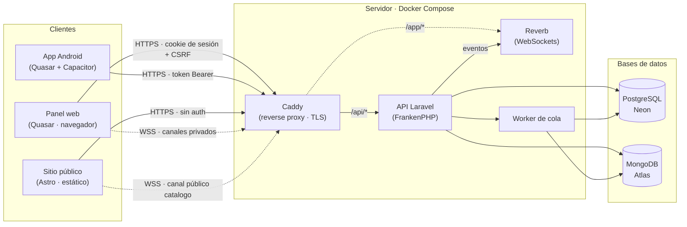
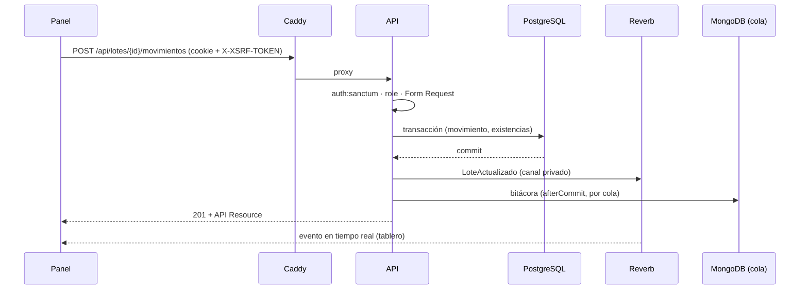
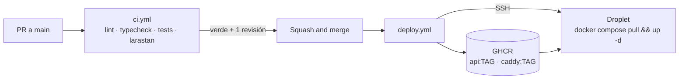

# Arquitectura

Vista general de las piezas del sistema, cómo se comunican y en qué entorno corre cada una. Las decisiones que la explican están en [`decisiones/`](./decisiones/README.md).

## Piezas



| Pieza              | Carpeta      | Quién la usa                              | Qué hace                                                                                                                             |
| ------------------ | ------------ | ----------------------------------------- | ------------------------------------------------------------------------------------------------------------------------------------ |
| **API**            | `apps/api`   | Todo lo demás                             | REST + WebSockets. Autenticación, roles, lotes, áreas, inventario, pedidos, notificaciones. Documentada con Scramble en `/docs/api`. |
| **Panel web**      | `apps/panel` | Administrador, ventas, encargados de área | Captura de todo, tablero en tiempo real, pedidos, chat de cotizaciones, impresión de etiquetas con QR.                               |
| **App Android**    | `apps/panel` | Encargados de área                        | **Solo lectura:** escanear el QR de un lote y ver estado, área e historial. Mismo código que el panel, compilado con Capacitor.      |
| **Sitio público**  | `apps/web`   | Clientes e invitados                      | Catálogo con especificaciones y disponibilidad en tiempo real, **sin precios**. Botón de cotizar.                                    |
| **Reverb**         | `apps/api`   | Panel y sitio                             | Servidor de WebSockets. Canales privados (tablero, notificaciones, chat) y público (`catalogo`).                                     |
| **Worker de cola** | `apps/api`   | API                                       | Trabajos en segundo plano: escrituras a MongoDB tras confirmar la transacción, correos, tareas pesadas.                              |
| **Caddy**          | `infra`      | Todos                                     | Reverse proxy, certificados TLS automáticos, sirve los builds estáticos del panel y el sitio.                                        |

## Cómo se comunican

**Panel → API.** Peticiones `fetch` con `credentials: 'include'`. Sanctum trata al panel como aplicación con estado: cookie de sesión `HttpOnly` más token CSRF en la cabecera `X-XSRF-TOKEN`. Detalle en [`autenticacion.md`](./autenticacion.md).

**App → API.** Mismas rutas, pero con `Authorization: Bearer <token>`. El token lleva abilities de solo lectura (`lotes:read`) y el backend las valida además del rol.

**Sitio → API.** Solo lectura de datos públicos, sin sesión. La disponibilidad inicial viene en el HTML estático (o en una petición pública) y se actualiza por WebSocket.

**Tiempo real.** La API emite eventos a Reverb; los clientes se suscriben con Laravel Echo. Los canales privados se autorizan en `/broadcasting/auth` con la misma cookie del panel. El canal público `catalogo` transmite solo `{ id, disponible }` (ADR-0005).

**Bases de datos.** PostgreSQL es la fuente de verdad: lotes, áreas, movimientos, insumos, existencias, pedidos, clientes, usuarios. MongoDB guarda bitácora e imprevistos, siempre referenciando el `lote_id` de Postgres y escribiendo solo después del commit (ADR-0003).

**Decimales.** Las columnas `decimal` (dinero, tarifas, cantidades de material) viajan en el JSON como cadenas (`"226.1100"`), no como números, para no perder precisión. En `@aleacion-prima/types` se tipan como `string` y el panel las convierte con `Number()` solo para mostrarlas. Los costos los calcula la API (`CalculadorCostoLote`); el panel no los recalcula.

## Flujo de una petición autenticada del panel



## Entornos

| Entorno         | Dónde corre                                  | PostgreSQL             | MongoDB            | URLs                                                                                           |
| --------------- | -------------------------------------------- | ---------------------- | ------------------ | ---------------------------------------------------------------------------------------------- |
| **Desarrollo**  | Docker local (backend) + `pnpm dev` (fronts) | Docker (`postgres:18`) | Docker (`mongo:7`) | API `:8000`, Reverb `:8080`, panel `:9000`, sitio `:4321`                                      |
| **Integración** | Solo las bases, para pruebas conjuntas       | Neon                   | Atlas              | Se apunta desde local cambiando `DB_*` / `MONGODB_URI` (solo lectura de pruebas; nunca migrar) |
| **Producción**  | Droplet de DigitalOcean, Docker Compose      | Neon (otra instancia)  | Atlas              | `tudominio.com` (sitio), `panel.tudominio.com`, `api.tudominio.com`                            |
| **Tests**       | CI y local                                   | SQLite en memoria      | Ninguno            | —                                                                                              |

No hay ambiente de staging (ADR-0007): el CI es el filtro y el rollback se hace cambiando el tag de la imagen.

## Despliegue



- Dos imágenes: `aleacion-prima-api` (FrankenPHP con Laravel) y `aleacion-prima-caddy` (Caddy con los builds del panel y el sitio ya dentro).
- Las variables públicas de los fronts (`PUBLIC_API_URL`, `PUBLIC_REVERB_*`) se inyectan **en tiempo de build** de la imagen de Caddy; cambiarlas implica reconstruir.
- `api.env` de producción lo genera el pipeline desde un secret; no se edita en el servidor.
- Rollback: cambiar `TAG` en el `.env` del servidor y `docker compose up -d`.

## Repositorio

```
apps/api        Laravel (Composer; fuera del workspace de pnpm)
apps/panel      Quasar: panel + app Android (src-capacitor/)
apps/web        Astro
packages/types  Tipos TS de la API compartidos por los tres fronts
packages/config ESLint, Prettier y tsconfig compartidos
scripts/        Scripts del repo en TS (setup, labels, pint)
e2e/            Playwright
infra/          Dockerfiles y Caddyfile
docs/           Esta carpeta
```

Los detalles de instalación están en el [README](../README.md); las reglas para asistentes de IA, en [AGENTS.md](../AGENTS.md).
