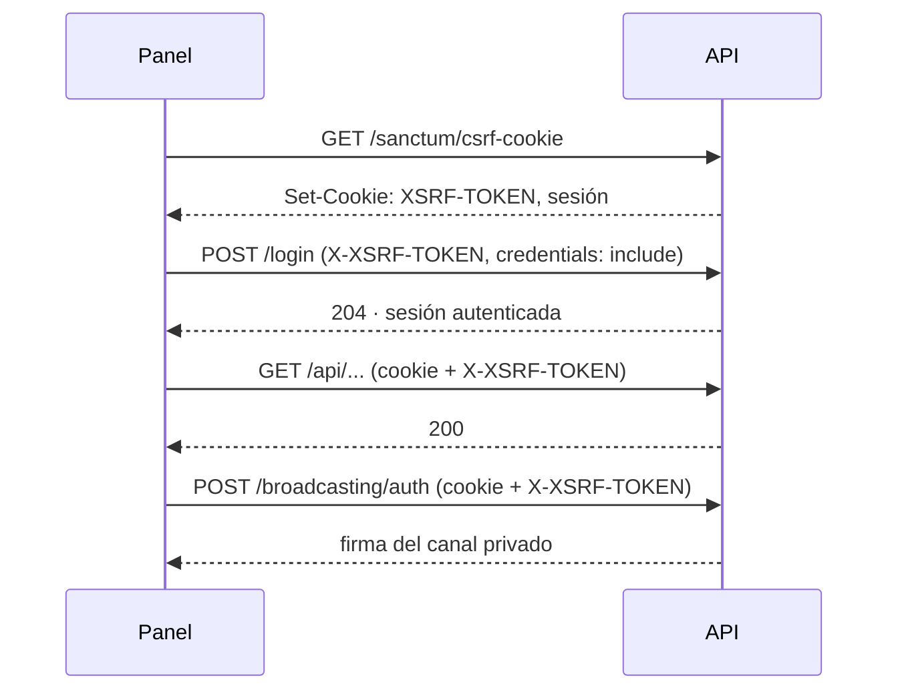

# Autenticación y autorización

Cómo entran a la API el panel, la app móvil y el sitio público, y qué variables hacen que funcione en cada entorno. Las decisiones están en [ADR-0001](./decisiones/0001-sanctum-sin-jwt.md) (Sanctum sin JWT) y [ADR-0002](./decisiones/0002-un-guard-roles-y-abilities.md) (un guard, roles y abilities).

## Resumen

| Cliente       | Cómo se autentica                                        | Middleware     | Qué más se valida                            |
| ------------- | -------------------------------------------------------- | -------------- | -------------------------------------------- |
| Panel web     | Cookie de sesión `HttpOnly` + `X-XSRF-TOKEN`             | `auth:sanctum` | Rol (`role:...`)                             |
| App Android   | `Authorization: Bearer <token>` con ability `lotes:read` | `auth:sanctum` | Rol **y** ability (`tokenCan('lotes:read')`) |
| Sitio público | Nada                                                     | —              | Solo rutas públicas de lectura               |

Un solo modelo `User`, un solo guard `web`, cuatro roles (`administrador`, `ventas`, `encargado`, `cliente`) definidos en `App\Enums\Rol` y gestionados con Spatie Permission.

## Panel: cookie de sesión + CSRF

El panel corre en otro origen que la API (`localhost:9000` vs `localhost:8000` en desarrollo; `panel.tudominio.com` vs `api.tudominio.com` en producción). Sanctum lo trata como aplicación "con estado" gracias a `$middleware->statefulApi()` en `bootstrap/app.php` y a que su origen está en `SANCTUM_STATEFUL_DOMAINS`.



En el código:

- `apps/panel/src/services/api.ts`: `createFetch` con `baseUrl: ${PUBLIC_API_URL}/api`, `credentials: 'include'` y `cabecerasApi()`, que agrega `Accept: application/json` y lee la cookie `XSRF-TOKEN` para mandarla como `X-XSRF-TOKEN`. `prepararCsrf()` llama a `/sanctum/csrf-cookie` y se ejecuta **antes del login**.
- `apps/panel/src/services/echo.ts`: `obtenerEcho()` crea el cliente de Echo de forma perezosa (nunca antes del login) con un `authorizer` propio que llama a `/broadcasting/auth` con cookie y CSRF. `desconectarEcho()` se llama al cerrar sesión.
- Cerrar sesión: `POST /logout` y luego `desconectarEcho()`.

## App móvil: token con abilities

La app no puede usar la cookie (origen `https://localhost` de Capacitor, fuera del navegador), así que al iniciar sesión pide un token personal:

```php
// En el controlador de login de la app
$token = $request->user()->createToken('movil', ['lotes:read'])->plainTextToken;
```

El token se guarda en el dispositivo y se manda en cada petición como `Authorization: Bearer <token>`. El backend valida el rol **y** la ability:

```php
Route::get('/lotes/{codigo}', ...)
    ->middleware(['auth:sanctum', 'role:encargado|administrador', 'ability:lotes:read']);
```

- Los tokens son opacos y se guardan hasheados en `personal_access_tokens`. Revocar = borrar la fila (desde el panel, o `POST /logout` desde la app).
- No expiran por sí solos salvo que se configure `expiration` en `config/sanctum.php`.
- El cliente HTTP del panel necesita una rama para el modo Capacitor (`import.meta.env.QUASAR_MODE === 'capacitor'`) que mande la cabecera `Authorization` en vez de la cookie y **no** llame a `/sanctum/csrf-cookie`.

## Sitio público

No se autentica. Solo consume rutas públicas de lectura (catálogo, disponibilidad inicial) y el canal público `catalogo` de Reverb, que no requiere `/broadcasting/auth`. Si el chat de cotizaciones del cliente registrado se implementa, vive en el panel (con una vista reducida para el rol `cliente`), no en el sitio, para que el sitio siga sin sesión.

## Roles y permisos

- Enum `App\Enums\Rol` (string): `administrador`, `ventas`, `encargado`, `cliente`. Spatie acepta enums: `$user->assignRole(Rol::Ventas)`.
- `User` usa el trait `HasRoles`. `RolesSeeder` crea los cuatro con `Role::findOrCreate($rol->value, 'web')` y es idempotente.
- Alias en `bootstrap/app.php`: `role`, `permission`, `role_or_permission` (Spatie), `abilities` y `ability` (Sanctum) y `activo` (propio: si el usuario tiene `activo = false`, borra sus tokens, cierra la sesión y responde 401).
- Toda ruta protegida lleva `['auth:sanctum', 'activo', 'role:...']`. Tres grupos según la tabla de arriba: `role:administrador|ventas` para ventas y catálogo interno, `role:administrador|encargado` para captura y lotes, `role:administrador` para catálogos y usuarios. El administrador siempre va en la lista; así "hereda" sin lógica extra. `tests/Feature/ControlAccesoTest.php` cubre los tres grupos.
- `GET /api/user` responde con `UsuarioResource`: `id`, `name`, `email`, `rol`, `activo` y, cuando se cargan, `areas`. Las respuestas de la API no van envueltas en `data` (`JsonResource::withoutWrapping()`).
- `DELETE /api/usuarios/{usuario}` no borra: da de baja (`activo = false`) y revoca los tokens. Un administrador **no puede darse de baja ni desactivarse a sí mismo** (la API responde 422); el panel oculta el botón de eliminar y deshabilita el de estado en su propia fila.
- `POST /login` limita a 5 intentos por minuto por correo e IP (`throttle:login`) y responde 429 con `auth.throttle`.
- Tipo compartido: `Rol` en `@aleacion-prima/types`, derivado de su arreglo `as const` con los mismos cuatro valores.
- **Por ahora solo roles.** Los permisos finos se agregan con cada historia de usuario: enum/constante → seeder → tipo en `types` → test, en el mismo PR.

| Rol             | Panel                                               | App móvil        | Sitio            |
| --------------- | --------------------------------------------------- | ---------------- | ---------------- |
| `administrador` | Todo                                                | Lectura de lotes | —                |
| `ventas`        | Pedidos, clientes, cotizaciones, catálogo interno   | —                | —                |
| `encargado`     | Captura de su área, lotes                           | Lectura de lotes | —                |
| `cliente`       | Chat de cotizaciones, vista reducida _(recortable)_ | —                | Catálogo público |

## Variables por entorno

### Sesión, Sanctum y CORS (`apps/api/.env` / `api.env`)

| Variable                   | Desarrollo                                                      | Producción                                                            |
| -------------------------- | --------------------------------------------------------------- | --------------------------------------------------------------------- |
| `SESSION_DOMAIN`           | `null`                                                          | `.tudominio.com`                                                      |
| `SESSION_SECURE_COOKIE`    | (sin definir)                                                   | `true`                                                                |
| `SANCTUM_STATEFUL_DOMAINS` | `localhost:9000`                                                | `panel.tudominio.com`                                                 |
| `CORS_ALLOWED_ORIGINS`     | `http://localhost:9000,http://localhost:4321,https://localhost` | `https://panel.tudominio.com,https://tudominio.com,https://localhost` |

- `https://localhost` es el origen de la app Android con Capacitor; va en ambos entornos.
- `config/cors.php`: `paths` = `api/*`, `sanctum/csrf-cookie`, `broadcasting/auth`; `supports_credentials: true`. Sin `supports_credentials` el navegador descarta la cookie.
- En `localhost` las cookies **no se separan por puerto**: verás cookies de otros proyectos locales. No afecta.

### Reverb

| Variable                 | Desarrollo              | Producción                                    |
| ------------------------ | ----------------------- | --------------------------------------------- |
| `REVERB_APP_ID`          | `aleacion`              | aleatorio                                     |
| `REVERB_APP_KEY`         | `aleacion-local`        | aleatorio (también como GitHub Variable)      |
| `REVERB_APP_SECRET`      | `aleacion-local-secret` | aleatorio (**nunca** en los fronts)           |
| `REVERB_ALLOWED_ORIGINS` | `localhost`             | `panel.tudominio.com,tudominio.com,localhost` |

Reverb compara solo el host; los WebSockets no pasan por CORS. La autorización de canales privados se configura en `bootstrap/app.php`: `->withBroadcasting(__DIR__.'/../routes/channels.php', ['middleware' => ['api', 'auth:sanctum']])`.

### Fronts (`PUBLIC_*`)

| Variable               | Desarrollo              | Producción                     |
| ---------------------- | ----------------------- | ------------------------------ |
| `PUBLIC_API_URL`       | `http://localhost:8000` | `https://api.tudominio.com`    |
| `PUBLIC_REVERB_HOST`   | `localhost`             | `api.tudominio.com`            |
| `PUBLIC_REVERB_PORT`   | `8080`                  | `443`                          |
| `PUBLIC_REVERB_SCHEME` | `http`                  | `https`                        |
| `PUBLIC_REVERB_KEY`    | `aleacion-local`        | `REVERB_APP_KEY` de producción |

En el panel se definen en `build.define` de `quasar.config.ts` y se tipan en `src/env.d.ts`; en el sitio, en `env.schema` de `astro.config.ts`. En producción se pasan como `build-args` al Dockerfile de Caddy. Para la app Android en desarrollo, `localhost` es el celular: usar `10.0.2.2` (emulador) o la IP de la máquina (físico).

## Cómo verificar

| Qué                   | Cómo                                                                                                                           | Esperado                                                    |
| --------------------- | ------------------------------------------------------------------------------------------------------------------------------ | ----------------------------------------------------------- |
| CORS                  | `curl -i -X OPTIONS http://localhost:8000/api/ping -H "Origin: http://localhost:9000" -H "Access-Control-Request-Method: GET"` | Cabecera `Access-Control-Allow-Origin`                      |
| Cookie CSRF           | En el navegador, pestaña Application → Cookies, tras `prepararCsrf()`                                                          | Cookie `XSRF-TOKEN` presente                                |
| Config que Laravel ve | `pnpm artisan config:show cors` / `sanctum` / `reverb`                                                                         | Coincide con el `.env`; si no, `docker compose restart api` |
| WebSocket             | Pestaña Network → WS → mensajes                                                                                                | `pusher:connection_established` (no solo el 101)            |
| Canal privado         | Suscribirse tras login y revisar `POST /broadcasting/auth`                                                                     | 200 con `auth` en la respuesta                              |

## Pendiente

- Probar `/broadcasting/auth` con un canal privado real (requiere el login del primer sprint).
- Implementar la rama Capacitor del cliente HTTP.
- Decidir la política de expiración de tokens de la app cuando haya usuarios reales.
