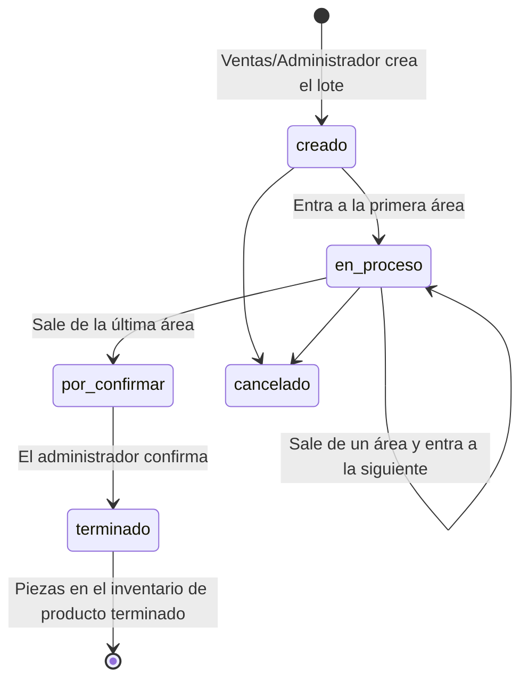
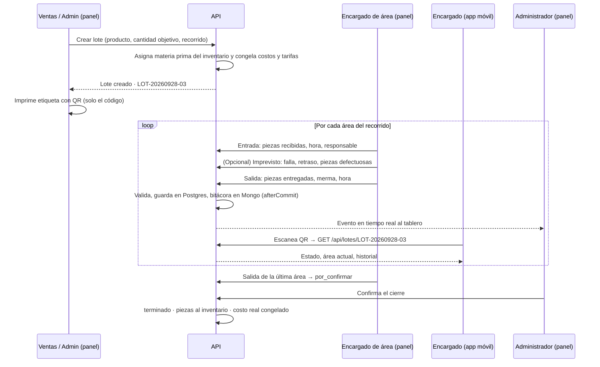

# Flujo de un lote

El recorrido de un lote de producción desde que se crea hasta que sus piezas entran al inventario, qué se registra en cada paso, dónde se guarda y cómo se calcula el costo real. Es el corazón del sistema y lo que define el criterio de éxito del MVP: _registrar un lote de inicio a fin, consultar su historial en tiempo real y calcular su costo final automáticamente_.

## Estados

Cinco estados en el enum `EstadoLote` (`creado`, `en_proceso`, `por_confirmar`, `terminado`, `cancelado`), más el campo `area_actual_id` que indica en cuál área está cuando el estado es `en_proceso`. El tipo `EstadoLote` se comparte en `@aleacion-prima/types`.

Un lote `terminado` **no se reabre**. Las correcciones se hacen con ajustes (ver abajo).

## Código del lote

Formato: **`LOT-AAAAMMDD-NN`**, por ejemplo `LOT-20260928-03` = tercer lote creado el 28 de septiembre de 2026.

- Fecha completa (año de cuatro dígitos) para que nadie la lea como día-mes-año.
- El consecutivo `NN` se reinicia cada día; con dos dígitos alcanza para 99 lotes diarios.
- Es lo que va en el QR de la etiqueta y lo que la app usa para consultar (ADR-0004). **Inmutable** una vez creado.
- No incluye producto ni turno: el producto ya se imprime en texto en la etiqueta, y la planta trabaja un solo turno.

Es el patrón más común en la industria (fecha + secuencia); si algún día hay varias plantas o turnos, se agrega un segmento sin tocar los códigos existentes.

## El recorrido

### 1. Creación

Lo hace ventas o el administrador desde el panel:

- **Producto** a fabricar y **cantidad objetivo** de piezas. Un lote es de un solo producto.
- **Recorrido de áreas.** Cada producto tiene un recorrido por defecto (`producto_area`); al crear el lote se prellena y se puede ajustar para casos especiales: quitar, agregar, reordenar o repetir paradas. Todo recorrido debe incluir las **áreas obligatorias** (`MOL → FUS → COL → DES`) en ese orden relativo; las opcionales (`GRA`, `CAL`, `EMP`) van donde se pongan. El recorrido queda guardado en el lote y ya no se lee del producto (ADR-0009). También se valida que el metal del lote quepa en una colada: `cantidad objetivo × metal por pieza ≤ 750 kg`.
- La API **asigna automáticamente la materia prima** desde el inventario de insumos según el producto y la cantidad, y **congela** en el lote el costo unitario de adquisición vigente y las tarifas por hora de cada área del recorrido. Así un cambio posterior de precios no altera lotes ya iniciados (riesgo RE-05).
- Cada insumo asignado conserva su **lote del proveedor** (`lote_proveedor`; en la industria, _heat number_) si el proveedor lo entregó: es el dato con el que se rastrea el material hasta su origen. La chatarra no lo trae. Se guarda en la entrada de inventario y, opcionalmente, en la asignación al lote; no forma parte del código del lote.
- Se genera el **código del lote** (`LOT-AAAAMMDD-NN`).
- Pedido asociado, si el lote se produce para un cliente en particular. _(Recortable: gestión de pedidos, sección 4.2 del anteproyecto.)_

Desde el panel se imprime la **etiqueta con el QR**, que solo contiene el código, y se pega en el lote físico.

### 2. Paso por cada área

El encargado registra desde el panel, idealmente **en el momento en que ocurre** (limitación del anteproyecto: captura manual; la trazabilidad vale lo que vale la captura).

| Momento | Qué se registra                                                                                                                                                                                             | Dónde                                     |
| ------- | ----------------------------------------------------------------------------------------------------------------------------------------------------------------------------------------------------------- | ----------------------------------------- |
| Entrada | Piezas recibidas, fecha/hora, responsable (el usuario que captura)                                                                                                                                          | PostgreSQL                                |
| Durante | Imprevistos: falla de máquina, retraso de material, piezas defectuosas, con descripción libre                                                                                                               | MongoDB (referencia `lote_id`, `area_id`) |
| Salida  | Piezas entregadas, **merma** en piezas (y material, opcional), fecha/hora. En la parada que separa piezas de canales y mazarotas (Desmolde), además el **retorno** en kg de metal que regresa al inventario | PostgreSQL                                |
| Siempre | Cada acción anterior queda en la **bitácora**                                                                                                                                                               | MongoDB                                   |

**Quién puede capturar.** Un encargado puede estar asignado a **una o varias áreas** (relación muchos a muchos usuario–área). Solo los encargados asignados a un área, o el administrador, capturan en ella.

**Reglas de validación:**

- Piezas entregadas ≤ piezas recibidas. La diferencia es la merma en piezas; la merma de material se captura aparte si aplica.
- Las piezas recibidas en el área N+1 se **prellenan** con las entregadas por el área N. Si el encargado captura otra cantidad, la diferencia queda registrada como discrepancia (esa diferencia es exactamente lo que hoy nadie ve).
- No se puede registrar la salida sin haber registrado la entrada.
- **Captura tardía permitida y marcada.** Cada movimiento guarda `registrado_en` (lo pone el servidor, no editable) y `ocurrido_en` (lo captura el encargado; por defecto es "ahora" y no puede ser futuro). Si difieren más de 30 minutos, la bitácora marca el movimiento como _captura tardía_. Prohibirla solo produciría horas falsas.

- La hora de entrada a una parada no puede ser anterior a la hora de salida de la parada anterior; sí pueden ser iguales (un encargado que cubre dos áreas consecutivas).
- El retorno de Desmolde genera un movimiento de inventario de tipo `retorno` sobre la chatarra de fundición y **se resta del costo de material** del lote; no es merma (ADR-0012).

Cada registro dispara un evento a Reverb para el tablero del administrador. Los imprevistos, además, generan una **alerta** en el centro de notificaciones.

### 3. Cierre

1. Al registrar la salida de la **última área**, el lote pasa a `por_confirmar`. Todavía no cuenta en inventario.
2. El **administrador confirma** desde el panel (para el MVP, un botón). Ese paso evita que un error de captura publique disponibilidad falsa en el sitio (riesgo RE-04).
3. Al confirmar: el lote pasa a `terminado`, las piezas entregadas entran al **inventario de producto terminado**, se emite el evento público `disponibilidad.actualizada` (solo `{ id, disponible }`) y se **congela el costo real**.

### Cancelación

Un lote en `creado` o `en_proceso` se puede cancelar (solo el administrador), con motivo obligatorio.

- Si el lote **no ha salido de su primera parada**, se puede devolver materia prima al inventario, insumo por insumo (movimiento `devolucion`). Después de esa parada ya no es materia prima y todo cuenta como consumido.
- La parada abierta **se cierra** con la hora de cancelación y 0 piezas entregadas, para que las horas trabajadas cuenten en el costo.
- El lote cancelado **conserva su costo**: es la pérdida real de ese lote.

### 4. Ajustes (en lugar de reabrir)

Un lote `terminado` no se edita. Si una captura estuvo mal:

- Se registra un **ajuste** sobre el movimiento afectado: valor anterior, valor nuevo, **motivo** y **responsable** (usuario que lo hace; solo administrador).
- El ajuste recalcula el costo real y, si cambia la cantidad de piezas terminadas, el inventario. Todo queda en la bitácora.
- Es el mismo mecanismo de los ajustes de inventario que el análisis de riesgos pide en RE-04; se implementa una sola vez y se usa para ambos.

## Costo real por lote

El anteproyecto define tres componentes: **material, mano de obra y tiempo de máquina**.

| Componente        | Cómo se obtiene                                                                                                                               | De dónde sale el dato                                                   |
| ----------------- | --------------------------------------------------------------------------------------------------------------------------------------------- | ----------------------------------------------------------------------- |
| Material          | Σ (cantidad asignada − devuelta) × costo unitario congelado, **menos** el retorno de metal (kg × costo vigente de la chatarra al registrarlo) | Asignación automática al crear; retorno capturado en Desmolde           |
| Mano de obra      | Σ por área (horas entre `ocurrido_en` de entrada y salida × tarifa de mano de obra del área)                                                  | **Catálogo de áreas**: tarifa por hora, congelada en el lote al crearlo |
| Tiempo de máquina | Σ por área (mismas horas × costo por hora de máquina del área)                                                                                | **Catálogo de áreas**: costo de máquina por hora, congelado en el lote  |
| **Costo real**    | Material + mano de obra + máquina                                                                                                             |                                                                         |
| Costo por pieza   | Costo real ÷ piezas terminadas confirmadas (la merma encarece cada pieza buena)                                                               |                                                                         |

- Las dos tarifas viven en el **catálogo de áreas** y solo el administrador las edita. Al crear un lote se copian a él, igual que el costo de material.
- El costo se **recalcula** en cada salida de área y en cada ajuste, y se muestra como "costo a la fecha" mientras el lote está abierto; se **congela** al confirmar el cierre.
- La merma no se "cobra" aparte: ya está dentro del material asignado y de las horas invertidas; lo que hace es subir el costo por pieza. Esa es la cifra que hoy la empresa no tiene.

## Qué ve cada quien

| Quién              | Dónde         | Qué                                                                                                                                    |
| ------------------ | ------------- | -------------------------------------------------------------------------------------------------------------------------------------- |
| Administrador      | Panel         | Tablero con todos los lotes en tiempo real, historial completo, costo real, alertas, confirmación de cierre, ajustes, tarifas por área |
| Ventas             | Panel         | Lotes ligados a sus pedidos, disponibilidad, costo real para cotizar                                                                   |
| Encargado de área  | Panel         | Captura en sus áreas; lotes que están o pasaron por ellas                                                                              |
| Encargado de área  | App móvil     | Escanear QR → estado, área actual e historial. Solo lectura                                                                            |
| Cliente / invitado | Sitio público | Disponibilidad del producto terminado. Nunca el lote, nunca el costo, nunca precios                                                    |

## Dónde vive cada dato

| Dato                                                                                 | Base       | Motivo                                                               |
| ------------------------------------------------------------------------------------ | ---------- | -------------------------------------------------------------------- |
| Lote, estado, código, producto, cantidad, recorrido, costo                           | PostgreSQL | Fuente de verdad, integridad referencial                             |
| Áreas, tarifas, asignación encargado–área                                            | PostgreSQL |                                                                      |
| Movimientos por área (entrada/salida, piezas, merma, `ocurrido_en`, `registrado_en`) | PostgreSQL | Se suman para el costo; deben ser consistentes                       |
| Asignación de materia prima, costos y tarifas congelados, lote del proveedor         | PostgreSQL | Dinero y trazabilidad del material                                   |
| Existencias (insumos y producto terminado) y sus ajustes                             | PostgreSQL | Dinero                                                               |
| Imprevistos                                                                          | MongoDB    | Estructura libre, alta frecuencia; referencian `lote_id` y `area_id` |
| Bitácora de eventos (incluye marcas de captura tardía y ajustes)                     | MongoDB    | Solo lectura después de escribirse; nunca se edita                   |

Ver [ADR-0003](./decisiones/0003-postgres-y-mongo.md): Mongo se escribe solo después del commit en Postgres.

## Decisiones tomadas en este flujo

Resueltas por el equipo; las difíciles de revertir tienen su ADR:

| #   | Decisión                                                                                      | ADR                                                               |
| --- | --------------------------------------------------------------------------------------------- | ----------------------------------------------------------------- |
| 1   | Recorrido por defecto por producto, ajustable al crear el lote; queda guardado en el lote     | [0009](./decisiones/0009-recorrido-por-lote.md)                   |
| 2   | El cierre lo dispara la última área, pero las piezas cuentan cuando el administrador confirma | [0010](./decisiones/0010-confirmacion-de-cierre.md)               |
| 3   | Un lote terminado no se reabre; se corrige con ajustes con motivo y responsable               | [0011](./decisiones/0011-sin-reapertura.md)                       |
| 4   | Un encargado puede cubrir varias áreas                                                        | —                                                                 |
| 5   | Captura tardía permitida y marcada (`registrado_en` vs `ocurrido_en`)                         | —                                                                 |
| 6   | Tarifas de mano de obra y máquina en el catálogo de áreas, congeladas por lote                | —                                                                 |
| 7   | Código `LOT-AAAAMMDD-NN`                                                                      | 0004 (ya cubre el contenido del QR; el formato se documenta aquí) |
| 8   | Los retornos de metal vuelven al inventario y se restan del costo; no son merma               | [0012](./decisiones/0012-retornos.md)                             |
| 9   | Todo recorrido incluye las áreas obligatorias en orden; las opcionales van donde se pongan    | 0009                                                              |

Pendiente de afinar con datos reales: si el consecutivo diario necesita más de dos dígitos.
