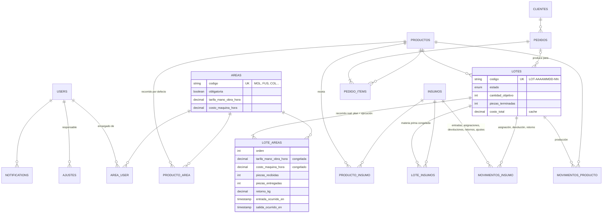

# Modelo de datos

> **Estado: definitivo (v1).** Deriva de [flujo-lote.md](./flujo-lote.md), [empresa.md](./empresa.md) y [ADR-0003](./decisiones/0003-postgres-y-mongo.md). Las migraciones del primer sprint se escriben a partir de aquí; después de eso, cualquier cambio de esquema es una migración más su nota en este archivo (y un ADR si es difícil de revertir). Los cuatro lo leen antes del Sprint 0.

## Vista general



Fuera del diagrama: `roles`, `permissions` y sus pivotes (Spatie), `personal_access_tokens` (Sanctum), `notifications` y las colecciones de MongoDB `bitacora` e `imprevistos`.

## Constantes de planta

Valores que describen a la planta y no cambian en operación; van en `config/planta.php` (con `.env` opcional), no en tablas:

| Clave                          | Valor     | Uso                                                                      |
| ------------------------------ | --------- | ------------------------------------------------------------------------ |
| `planta.umbral_captura_tardia` | 30 (min)  | `registrado_en − ocurrido_en` mayor → `captura_tardia` en bitácora       |
| `planta.capacidad_colada_kg`   | 750       | Un lote es una colada: `cantidad_objetivo × metal por pieza ≤ capacidad` |
| `planta.insumo_retorno`        | `CHT-FUN` | Insumo al que regresan los retornos de metal (decisión 14)               |

Si algún día hay dos hornos o dos plantas, esto se convierte en columnas de `areas`; ese día se escribe un ADR.

## PostgreSQL

Convenciones: ids `bigint` autoincrementales (default de Laravel); `created_at`/`updated_at` en todas; cantidades de piezas `integer`; cantidades de material `decimal(12,3)`; dinero y tarifas `decimal(14,4)`; catálogos con `codigo` único corto y `activo boolean` en vez de borrado.

### Catálogos

**`areas`** — paradas de la planta.

| Columna                 | Tipo          | Notas                                                                    |
| ----------------------- | ------------- | ------------------------------------------------------------------------ |
| `codigo`                | string, único | `MOL`, `FUS`, `COL`, `DES`, `GRA`, `CAL`, `EMP`                          |
| `nombre`                | string, único |                                                                          |
| `descripcion`           | text, null    | Equipo, notas                                                            |
| `tarifa_mano_obra_hora` | decimal(14,4) | Solo la edita el administrador                                           |
| `costo_maquina_hora`    | decimal(14,4) | Ídem                                                                     |
| `obligatoria`           | boolean       | Todo recorrido la incluye, en el orden relativo del catálogo (dec. 17)   |
| `orden_catalogo`        | integer       | Orden natural de la planta; define el orden relativo de las obligatorias |
| `activo`                | boolean       | Un área inactiva no entra en recorridos nuevos                           |

**`area_user`** — pivote encargado ↔ área. Un encargado puede cubrir varias áreas.

| Columna   | Tipo | Notas                      |
| --------- | ---- | -------------------------- |
| `area_id` | fk   | Único `(area_id, user_id)` |
| `user_id` | fk   |                            |

**`productos`** — lo que se fabrica y se vende.

| Columna            | Tipo          | Notas                                                        |
| ------------------ | ------------- | ------------------------------------------------------------ |
| `codigo`           | string, único | `DIS-FRE-G`, `CAJ-TRA-N`…                                    |
| `nombre`           | string        |                                                              |
| `especificaciones` | jsonb         | Lo que muestra el sitio: material, peso, medidas, norma      |
| `precio_mayoreo`   | decimal(14,4) | **Nunca sale por la API pública ni por el canal `catalogo`** |
| `precio_menudeo`   | decimal(14,4) | Ídem                                                         |
| `existencia`       | integer       | Cache de producto terminado (ver `movimientos_producto`)     |
| `publicado`        | boolean       | Si aparece en el sitio público                               |
| `activo`           | boolean       |                                                              |

**`producto_area`** — recorrido por defecto del producto. Debe cumplir la validación de recorrido (abajo).

| Columna       | Tipo    | Notas                              |
| ------------- | ------- | ---------------------------------- |
| `producto_id` | fk      | Único `(producto_id, orden)`       |
| `area_id`     | fk      |                                    |
| `orden`       | integer | Posición en el recorrido: 1, 2, 3… |

**`producto_insumo`** — receta del producto. Es lo que permite la asignación automática de materia prima al crear el lote; en `empresa.md` está la regla con la que se calculan las cantidades.

| Columna              | Tipo          | Notas                            |
| -------------------- | ------------- | -------------------------------- |
| `producto_id`        | fk            | Único `(producto_id, insumo_id)` |
| `insumo_id`          | fk            |                                  |
| `cantidad_por_pieza` | decimal(12,4) |                                  |

**`insumos`** — materias primas.

| Columna          | Tipo                                | Notas                                                               |
| ---------------- | ----------------------------------- | ------------------------------------------------------------------- |
| `codigo`         | string, único                       | `CHT-FUN`, `NOD-FSM`…                                               |
| `nombre`         | string, único                       |                                                                     |
| `categoria`      | enum `metal` / `moldeo` / `empaque` | `metal` cuenta para la capacidad de colada y puede recibir retornos |
| `unidad`         | string                              | `kg`, `pieza`                                                       |
| `costo_unitario` | decimal(14,4)                       | Costo vigente; se congela en cada lote                              |
| `existencia`     | decimal(12,3)                       | Cache (ver `movimientos_insumo`)                                    |
| `stock_minimo`   | decimal(12,3)                       | Dispara la alerta de stock mínimo                                   |
| `activo`         | boolean                             |                                                                     |

### Inventario (libro mayor + cache)

**`movimientos_insumo`** — cada movimiento de materia prima. Es la fuente de verdad; `insumos.existencia` es la suma y se actualiza en la misma transacción.

| Columna          | Tipo                                                                | Notas                                                                                |
| ---------------- | ------------------------------------------------------------------- | ------------------------------------------------------------------------------------ |
| `insumo_id`      | fk                                                                  |                                                                                      |
| `tipo`           | enum `entrada` / `asignacion` / `devolucion` / `retorno` / `ajuste` | Ver signos                                                                           |
| `cantidad`       | decimal(12,3), con signo                                            | `entrada`, `devolucion`, `retorno` +; `asignacion` −; `ajuste` ±                     |
| `costo_unitario` | decimal(14,4), null                                                 | En `entrada`: costo de compra. En `retorno`: costo vigente del insumo al registrarlo |
| `lote_proveedor` | string, null                                                        | Número de colada o lote del proveedor, en entradas (dec. 5)                          |
| `proveedor`      | string, null                                                        | Texto libre (no hay gestión de proveedores)                                          |
| `lote_id`        | fk, null                                                            | En `asignacion`, `devolucion` y `retorno`                                            |
| `motivo`         | text, null                                                          | Obligatorio en `ajuste`                                                              |
| `user_id`        | fk                                                                  | Quién lo registró                                                                    |
| `ocurrido_en`    | timestamp                                                           |                                                                                      |

**`movimientos_producto`** — lo mismo para producto terminado. `productos.existencia` es su suma; la disponibilidad que ve el sitio es esa columna (ver deuda 1).

| Columna       | Tipo                                   | Notas                                 |
| ------------- | -------------------------------------- | ------------------------------------- |
| `producto_id` | fk                                     |                                       |
| `tipo`        | enum `produccion` / `venta` / `ajuste` |                                       |
| `cantidad`    | integer, con signo                     | `produccion` +; `venta` −; `ajuste` ± |
| `lote_id`     | fk, null                               | En `produccion`                       |
| `pedido_id`   | fk, null                               | En `venta`                            |
| `motivo`      | text, null                             | Obligatorio en `ajuste`               |
| `user_id`     | fk                                     | Quién lo registró                     |
| `ocurrido_en` | timestamp                              |                                       |

### Lotes

**`lotes`**

| Columna              | Tipo                | Notas                                                             |
| -------------------- | ------------------- | ----------------------------------------------------------------- |
| `codigo`             | string, único       | `LOT-AAAAMMDD-NN`; inmutable                                      |
| `producto_id`        | fk                  |                                                                   |
| `pedido_id`          | fk, null            | Si se produce para un pedido (recortable)                         |
| `cantidad_objetivo`  | integer             | En las paradas previas al desmolde son moldes (uno por pieza)     |
| `estado`             | enum `EstadoLote`   | `creado`, `en_proceso`, `por_confirmar`, `terminado`, `cancelado` |
| `area_actual_id`     | fk, null            | Solo con estado `en_proceso`                                      |
| `piezas_terminadas`  | integer, null       | Se fija al confirmar                                              |
| `costo_material`     | decimal(14,4)       | Cache; se recalcula en cada salida, retorno y ajuste              |
| `costo_mano_obra`    | decimal(14,4)       | Cache                                                             |
| `costo_maquina`      | decimal(14,4)       | Cache                                                             |
| `costo_total`        | decimal(14,4)       | Cache = suma de los tres                                          |
| `costo_por_pieza`    | decimal(14,4), null | Cache; `costo_total / piezas_terminadas` al confirmar             |
| `creado_por`         | fk users            |                                                                   |
| `confirmado_por`     | fk users, null      |                                                                   |
| `confirmado_en`      | timestamp, null     |                                                                   |
| `cancelado_por`      | fk users, null      |                                                                   |
| `cancelado_en`       | timestamp, null     |                                                                   |
| `motivo_cancelacion` | text, null          |                                                                   |

**`lote_areas`** — una fila por parada del recorrido. Guarda el **plan** (orden y tarifas congeladas) y la **ejecución** (entrada y salida) en la misma fila.

| Columna                 | Tipo                | Notas                                                                                             |
| ----------------------- | ------------------- | ------------------------------------------------------------------------------------------------- |
| `lote_id`, `area_id`    | fk                  | Único `(lote_id, orden)`; la misma área puede repetirse con otro `orden` (retrabajo)              |
| `orden`                 | integer             | 1, 2, 3…                                                                                          |
| `tarifa_mano_obra_hora` | decimal(14,4)       | Copiada de `areas` al crear el lote                                                               |
| `costo_maquina_hora`    | decimal(14,4)       | Ídem                                                                                              |
| `piezas_recibidas`      | integer, null       | Null = todavía no entra. Se prellena con las entregadas de la parada anterior                     |
| `entrada_ocurrido_en`   | timestamp, null     | Lo captura el encargado; no puede ser futuro                                                      |
| `entrada_registrado_en` | timestamp, null     | Lo pone el servidor                                                                               |
| `entrada_user_id`       | fk, null            |                                                                                                   |
| `piezas_entregadas`     | integer, null       | ≤ `piezas_recibidas`                                                                              |
| `merma_piezas`          | integer, null       | = recibidas − entregadas (se guarda para consultas)                                               |
| `merma_material`        | decimal(12,3), null | Opcional; material perdido en la parada, en `kg` (dec. 12)                                        |
| `retorno_kg`            | decimal(12,3), null | Metal que regresa al inventario (canales, mazarotas, piezas rotas); genera el `retorno` (dec. 14) |
| `salida_ocurrido_en`    | timestamp, null     | ≥ `entrada_ocurrido_en`                                                                           |
| `salida_registrado_en`  | timestamp, null     |                                                                                                   |
| `salida_user_id`        | fk, null            |                                                                                                   |

Horas de la parada = `salida_ocurrido_en − entrada_ocurrido_en`. Mano de obra de la parada = horas × `tarifa_mano_obra_hora`; máquina, igual con `costo_maquina_hora`.

**`lote_insumos`** — materia prima asignada al lote, con el costo congelado.

| Columna                | Tipo          | Notas                                                |
| ---------------------- | ------------- | ---------------------------------------------------- |
| `lote_id`, `insumo_id` | fk            | Único                                                |
| `cantidad`             | decimal(12,3) | `cantidad_por_pieza × cantidad_objetivo` al crear    |
| `costo_unitario`       | decimal(14,4) | Copiado de `insumos.costo_unitario` al crear         |
| `cantidad_devuelta`    | decimal(12,3) | 0 por defecto; se llena solo al cancelar (ver abajo) |
| `lote_proveedor`       | string, null  | Ver decisión 5                                       |

### Costo real (lo que calcula `CalculadorCostoLote`)

```
material     = Σ lote_insumos (cantidad − cantidad_devuelta) × costo_unitario
             − Σ movimientos_insumo[tipo = retorno, lote_id] cantidad × costo_unitario
mano_obra    = Σ lote_areas horas × tarifa_mano_obra_hora
maquina      = Σ lote_areas horas × costo_maquina_hora
total        = material + mano_obra + maquina
por_pieza    = total ÷ piezas_terminadas          (solo al confirmar)
```

Solo `CalculadorCostoLote` escribe las columnas `costo_*` de `lotes`. Se ejecuta en cada salida de parada, cada retorno, cada ajuste y al confirmar; `artisan lotes:recalcular` lo corre para todos (deuda 2).

### Validaciones

Las aplica la API (Form Requests + servicios); las que la BD puede garantizar sola, también van como restricción.

| Regla                                                                                                                                                     | Dónde         |
| --------------------------------------------------------------------------------------------------------------------------------------------------------- | ------------- |
| El recorrido (producto o lote) incluye todas las áreas obligatorias activas, en el orden relativo de `orden_catalogo`; las opcionales van donde se pongan | API           |
| `cantidad_objetivo × Σ receta[categoria = metal] ≤ planta.capacidad_colada_kg`                                                                            | API           |
| `piezas_entregadas ≤ piezas_recibidas`                                                                                                                    | API + `CHECK` |
| `salida_ocurrido_en ≥ entrada_ocurrido_en`                                                                                                                | API + `CHECK` |
| `entrada_ocurrido_en` de la parada N+1 ≥ `salida_ocurrido_en` de la parada N (dec. 16)                                                                    | API           |
| `ocurrido_en ≤ now()` en toda captura                                                                                                                     | API           |
| No hay salida sin entrada; no hay entrada en N+1 sin salida en N                                                                                          | API           |
| `retorno_kg ≤ Σ lote_insumos[categoria = metal] cantidad`                                                                                                 | API           |
| Solo encargados de esa área (`area_user`) o el administrador capturan en ella                                                                             | Policy        |
| Devolución de insumos solo con `orden = 1` sin salida                                                                                                     | API           |
| `ajustes`: exactamente una FK no nula                                                                                                                     | `CHECK`       |

### Cancelación

La materia prima cambia de naturaleza en la primera parada (entra chatarra y arena, sale un molde armado o metal fundido), así que solo se puede devolver mientras el lote **no haya registrado salida de su primera parada** (`lote_areas` con `orden = 1` y `salida_ocurrido_en IS NULL`).

- Al cancelar se captura por cada `lote_insumos` la `cantidad_devuelta` (0 ≤ devuelta ≤ asignada). Si el lote ya salió de la primera parada, se bloquea en 0: todo cuenta como consumido.
- Cada devolución genera un `movimientos_insumo` de tipo `devolucion` (positivo, con `lote_id`).
- **La parada abierta se cierra** (dec. 15): `salida_ocurrido_en = cancelado_en`, `piezas_entregadas = 0`, `salida_user_id = cancelado_por`. Así las horas trabajadas entran al costo sin regla especial.
- El lote cancelado **conserva su costo** (material consumido + horas registradas). Es la pérdida real y no se pone en cero.
- Las piezas a medio hacer son merma; quedan en la bitácora con el motivo. Si hay metal recuperable, se captura como `retorno_kg` de la parada cerrada.

### Ajustes

**`ajustes`** — una sola tabla para corregir cualquier cosa ya registrada: lote terminado, existencias, movimientos. En vez de una relación polimórfica usa un **arco exclusivo**: cuatro llaves foráneas nulas y una restricción `CHECK` que obliga a que exactamente una tenga valor, así la BD garantiza que ningún ajuste apunta al vacío.

| Columna          | Tipo     | Notas                                                                 |
| ---------------- | -------- | --------------------------------------------------------------------- |
| `lote_area_id`   | fk, null | Uno y solo uno de estos cuatro                                        |
| `lote_insumo_id` | fk, null |                                                                       |
| `insumo_id`      | fk, null |                                                                       |
| `producto_id`    | fk, null |                                                                       |
| `campo`          | string   | Qué columna cambió (`piezas_entregadas`, `retorno_kg`, `existencia`…) |
| `valores`        | jsonb    | `{ "anterior": 48, "nuevo": 47 }`; conserva el tipo                   |
| `motivo`         | text     | Obligatorio                                                           |
| `user_id`        | fk       | Solo administrador                                                    |

```sql
ALTER TABLE ajustes ADD CONSTRAINT ajustes_un_objetivo
  CHECK (num_nonnulls(lote_area_id, lote_insumo_id, insumo_id, producto_id) = 1);
```

Un ajuste sobre existencias crea además su `movimientos_insumo` / `movimientos_producto` de tipo `ajuste`; uno sobre `lote_areas` o `lote_insumos` recalcula los costos del lote y, si cambia `piezas_entregadas` de la última parada de un lote terminado, también `piezas_terminadas` y el inventario. Todo se escribe en la bitácora. Si aparece un quinto tipo ajustable, se agrega la columna y se actualiza el `CHECK` en una migración.

### Ventas (recortable)

**`clientes`** — clientes empresariales.

| Columna             | Tipo     | Notas                                                       |
| ------------------- | -------- | ----------------------------------------------------------- |
| `razon_social`      | string   |                                                             |
| `rfc`               | text     | Cifrado (`encrypted` cast)                                  |
| `direccion_fiscal`  | text     | Cifrada                                                     |
| `contacto_nombre`   | string   |                                                             |
| `contacto_correo`   | string   |                                                             |
| `contacto_telefono` | string   |                                                             |
| `condiciones_pago`  | text     |                                                             |
| `user_id`           | fk, null | Solo si el cliente tiene acceso al panel (chat, recortable) |
| `activo`            | boolean  |                                                             |

**`pedidos`**

| Columna       | Tipo                                                       | Notas               |
| ------------- | ---------------------------------------------------------- | ------------------- |
| `cliente_id`  | fk                                                         |                     |
| `estado`      | enum `borrador` / `confirmado` / `entregado` / `cancelado` |                     |
| `estado_pago` | enum `pendiente` / `parcial` / `pagado`                    | Se actualiza a mano |
| `notas`       | text, null                                                 |                     |
| `creado_por`  | fk users                                                   |                     |

**`pedido_items`**

| Columna           | Tipo          | Notas                            |
| ----------------- | ------------- | -------------------------------- |
| `pedido_id`       | fk            |                                  |
| `producto_id`     | fk            |                                  |
| `cantidad`        | integer       |                                  |
| `precio_unitario` | decimal(14,4) | Congelado al confirmar el pedido |

### Usuarios, roles, notificaciones

**`users`** — la de Laravel más `activo`. Los roles (`administrador`, `ventas`, `encargado` y, si entra el chat, `cliente`) van en las tablas de Spatie; las áreas que cubre un encargado, en `area_user`.

| Columna             | Tipo            | Notas                             |
| ------------------- | --------------- | --------------------------------- |
| `name`              | string          |                                   |
| `email`             | string, único   | Usuario de inicio de sesión       |
| `password`          | string          | Hash bcrypt; nunca sale en la API |
| `email_verified_at` | timestamp, null | Columna estándar de Laravel       |
| `remember_token`    | string, null    | Columna estándar de Laravel       |
| `activo`            | boolean         | Baja lógica                       |

**`notifications`** — la tabla estándar de Laravel. Es el **centro de notificaciones**: imprevistos, stock mínimo, lotes por confirmar. Cada notificación se emite además por Reverb al canal privado del usuario.

| Columna                            | Tipo            | Notas                               |
| ---------------------------------- | --------------- | ----------------------------------- |
| `id`                               | uuid            | En lugar del `bigint` de las demás  |
| `type`                             | string          | Clase de la notificación            |
| `notifiable_type`, `notifiable_id` | string / bigint | Polimórfica → `users`; destinatario |
| `data`                             | jsonb           | Contenido del aviso                 |
| `read_at`                          | timestamp, null | Null = sin leer                     |

**`personal_access_tokens`** — la de Sanctum, para la app móvil.

| Columna                          | Tipo              | Notas                                           |
| -------------------------------- | ----------------- | ----------------------------------------------- |
| `tokenable_type`, `tokenable_id` | string / bigint   | Polimórfica → `users`; dueño del token          |
| `name`                           | string            | `movil`                                         |
| `token`                          | string(64), único | Hash; el texto plano solo se entrega al crearlo |
| `abilities`                      | text, null        | `["lotes:read"]`                                |
| `last_used_at`                   | timestamp, null   |                                                 |
| `expires_at`                     | timestamp, null   |                                                 |

### Orden sugerido de migraciones

`users` (+`activo`) → Spatie → `areas` → `area_user` → `insumos` → `productos` → `producto_area` → `producto_insumo` → `clientes` → `pedidos` → `pedido_items` → `lotes` → `lote_areas` → `lote_insumos` → `movimientos_insumo` → `movimientos_producto` → `ajustes` → `notifications` → Sanctum. Los `CHECK` van en la misma migración de su tabla con `DB::statement`.

## MongoDB

**`bitacora`** — todo lo que pasa, en orden. Nunca se edita ni se borra.

```jsonc
{
  "lote_id": 42, // referencia a Postgres; null para eventos sin lote (stock mínimo)
  "area_id": 4, // null si no aplica
  "tipo": "salida_area", // creacion, asignacion_insumo, entrada_area, salida_area, imprevisto,
  // retorno, devolucion_insumo, cancelacion, confirmacion, ajuste, stock_minimo
  "descripcion": "Salida de Desmolde: 48 piezas, merma 2, retorno 162 kg",
  "datos": { "piezas_entregadas": 48, "merma_piezas": 2, "retorno_kg": 162 }, // snapshot libre
  "user_id": 5,
  "ocurrido_en": "2026-09-25T14:30:00Z",
  "registrado_en": "2026-09-25T14:36:12Z",
  "captura_tardia": false, // registrado − ocurrido > planta.umbral_captura_tardia
  "created_at": "2026-09-25T14:36:12Z",
}
```

Índices: `{ lote_id: 1, created_at: 1 }`, `{ tipo: 1, created_at: -1 }`, `{ captura_tardia: 1, created_at: -1 }`.

**`imprevistos`** — con un campo **tipado** además del texto libre, porque el objetivo específico 3 pide _detectar patrones_, y sobre texto libre no se agrupa nada.

```jsonc
{
  "lote_id": 44,
  "area_id": 2,
  "tipo": "falla_maquina", // falla_maquina, retraso_material, pieza_defectuosa, otro
  "descripcion": "Caída de tensión; el horno perdió potencia 40 min y el baño bajó a 1,380 °C.",
  "maquina": "Horno de inducción 750 kg", // texto libre, opcional
  "piezas_afectadas": null, // opcional
  "duracion_minutos": 40, // opcional; tiempo perdido
  "resuelto": true,
  "user_id": 4,
  "ocurrido_en": "2026-09-28T17:20:00Z",
  "created_at": "2026-09-28T17:32:30Z",
}
```

Índices: `{ lote_id: 1 }`, `{ area_id: 1, tipo: 1, ocurrido_en: -1 }`.

Ambas colecciones se escriben **después** del commit de Postgres (ADR-0003). Los reportes de imprevistos por área/tipo/mes se consultan en Mongo y se enriquecen con nombres desde Postgres en PHP.

## Decisiones de diseño y por qué

1. **`lote_areas` guarda plan y ejecución en la misma fila**, en lugar de una tabla de eventos. El costo necesita el par entrada–salida y con una fila por parada es una resta; "no hay salida sin entrada" es `entrada_ocurrido_en IS NOT NULL`; el historial es `ORDER BY orden`. Una parada = un paso por el área; el retrabajo es otra fila con otro `orden`. La bitácora conserva el detalle evento por evento.

2. **Inventario como libro mayor + columna cache.** Los movimientos son la verdad; `existencia` es la suma, actualizada en la misma transacción. La alerta de stock mínimo y la disponibilidad del sitio leen un número sin sumar la tabla; el libro mayor da auditoría (RE-04) y permite recalcular (`artisan inventario:recalcular`).

3. **Receta por producto (`producto_insumo`).** Sin lista de materiales no hay asignación automática. `empresa.md` define las recetas con una regla única (peso ÷ rendimiento × pérdida de horno), así que el consumo por pieza es predecible.

4. **Costos congelados por copia, no por referencia.** `lote_areas` copia las tarifas y `lote_insumos` el costo unitario al crear el lote. Un cambio en `areas` o `insumos` no toca lotes existentes (RE-05). Duplicación intencional.

5. **Lote del proveedor simplificado.** La columna se llama `lote_proveedor` y no `numero_colada`: en fundición "colada" es el vertido y ya hay un área `COL`. Se guarda en las entradas y opcionalmente en `lote_insumos`; la chatarra no lo trae. No se modela FIFO por entrada; si se exige trazabilidad estricta por lote de proveedor, se agrega `entrada_id` a `lote_insumos` con consumo parcial y un ADR.

6. **Costos cacheados en `lotes`.** Se recalculan en cada salida, retorno y ajuste, y se congelan al confirmar; el tablero muestra "costo a la fecha" sin calcular al vuelo. Mitigación de la desincronización: un solo servicio escribe y un comando recalcula.

7. **Precios en `productos`.** Mayoreo y menudeo como columnas, sin historial; el precio real se congela en `pedido_items`. El riesgo es filtrarlos: el Resource público y `broadcastWith()` no los incluyen, y hay un test que lo verifica.

8. **`ajustes` con arco exclusivo, no polimórfica.** La BD no puede poner FK sobre `(type, id)`; con cuatro FK nulas y `CHECK (num_nonnulls(...) = 1)` Postgres garantiza que ningún ajuste apunta al vacío. `valores` es `jsonb` para conservar el tipo. El costo es migrar si aparece un quinto tipo. Lo polimórfico se deja donde ya viene resuelto (`notifications`).

9. **Cancelación con devolución condicionada.** Solo se devuelve materia prima si el lote no ha salido de su primera parada. El lote cancelado conserva su costo porque esa es la pérdida real.

10. **`notifications` de Laravel** en lugar de una tabla propia.

11. **Imprevistos con `tipo` cerrado.** Cuatro valores más `otro`; es lo que permite el reporte "fallas de máquina por área en el mes".

12. **La merma se mide en piezas; `merma_material` es opcional y no hay `lote_area_mermas`.** En esta planta el material que no acaba en pieza es retorno (decisión 14) o pérdida de horno (ya dentro de la receta); una tabla de mermas por insumo sería captura extra sin consulta que la use. Si otro giro la necesita, se agrega ese día.

13. **El imprevisto `pieza_defectuosa` no toca `lote_areas`.** Documenta el problema en Mongo; la merma real se registra una sola vez, en la salida de la parada. Así no se cuenta dos veces.

14. **Retornos.** Entre 15 % y 25 % del metal colado vuelve al horno como canales, mazarotas y piezas rotas; contarlo como merma inflaría el costo por pieza justo en lo que el sistema promete medir. La parada que separa (Desmolde) captura `retorno_kg`; la API genera un `movimientos_insumo` de tipo `retorno` sobre `planta.insumo_retorno` con el costo vigente, y `CalculadorCostoLote` lo resta del material. Las piezas rechazadas después del desmolde son merma del lote; físicamente regresan al horno con una `entrada` manual, fuera del costo del lote.

15. **Cancelar cierra la parada abierta** con `salida_ocurrido_en = cancelado_en` y `piezas_entregadas = 0`. Alternativa descartada: dejar la salida en null y que el calculador use `cancelado_en` como fin; es una regla especial más en el código y una fila "abierta" en un lote cerrado.

16. **La entrada a N+1 no puede ser anterior a la salida de N.** Un encargado que cubre dos áreas consecutivas puede capturar ambas en el mismo minuto, y eso está bien; lo que no puede es invertir el orden del tiempo. Validación en la API, no `CHECK` (cruza filas).

17. **Áreas obligatorias.** Nada sale de la planta sin `MOL → FUS → COL → DES`; `GRA`, `CAL` y `EMP` son opcionales. `areas.obligatoria` + `orden_catalogo` bastan para validar cualquier recorrido, y son lo que el componente de recorrido pinta con candado. Alternativa descartada: un mínimo numérico de paradas, que no dice nada de cuáles.

18. **Constantes de planta en `config/planta.php`.** Umbral de captura tardía, capacidad de colada e insumo de retorno describen a _esta_ planta, única y de un horno; una tabla de configuración para tres valores es más superficie que valor.

19. **`codigo` corto y único en `areas`, `productos` e `insumos`.** Es lo que se muestra en el componente de recorrido, en etiquetas y en la bitácora, y lo que el seeder usa para referenciar sin ids.

## Deuda conocida

1. **Existencia vs. apartado.** `productos.existencia` asume que todo producto terminado está disponible. Con pedidos (recortable) la disponibilidad real es `existencia − apartado`. Se resuelve cuando pedidos entre al MVP: columna `apartado` cache o vista sobre `pedido_items` confirmados.
2. **La cache de costos** puede desincronizarse si alguien edita `lote_areas` sin pasar por el servicio (Tinker, seeder). El seeder debe crear lotes a través de los servicios, no insertando columnas `costo_*`; `artisan lotes:recalcular` es la red.
3. **Trazabilidad FIFO por lote de proveedor**, si algún cliente la exige (decisión 5).
